# 学生毕业离校系统

> 🎓 **计算机毕业设计 · 学生毕业离校系统**
>
> 本仓库只放**项目介绍 + 运行截图**（截图是站点带水印的原图，存在仓库 `images/` 里）。
>
> 👉 **完整可运行源码 / 数据库脚本 / 部署文档：[点我获取](https://geekcode.top/archives/%E5%AD%A6%E7%94%9F%E6%AF%95%E4%B8%9A%E7%A6%BB%E6%A0%A1%E7%B3%BB%E7%BB%9F?utm_source=github)**
>
> 💬 咨询微信：**ir9372**　|　🌐 更多项目：[极客代码 geekcode.top](https://geekcode.top/?utm_source=github)
>
> 📌 项目详情页：<https://geekcode.top/archives/%E5%AD%A6%E7%94%9F%E6%AF%95%E4%B8%9A%E7%A6%BB%E6%A0%A1%E7%B3%BB%E7%BB%9F?utm_source=github>

<table><td width="230" align="center"> <b>扫码加微信 ir9372</b></td><td valign="middle">📦 源码 = 项目介绍 + 全部运行截图 + 数据库 + 部署文档 👉 点上方任意截图，直接跳到 <b>极客代码 geekcode.top</b> 详情页</td></table>

---

<h1>学生毕业离校系统</h1>
<h2>项目概述</h2>

本项目为“学生毕业离校系统”，旨在解决高校学生毕业季多部门协同办理离校手续效率低、流程不透明及信息分散的问题。系统采用前后端一体化架构，基于 Spring Boot 后端框架与 Vue 前端技术构建，实现了从离校流程申请、论文审核、费用结算到教师评价的全链路数字化管理。核心功能涵盖前台用户端的离校流程浏览、公告查看、留言反馈及个人收藏管理，以及后台管理端对业务数据、用户权限及系统配置的全面管控。适用人群包括在校毕业生、指导教师、教务管理人员及系统管理员。通过 Shiro 安全框架保障访问控制，MyBatis-Plus 提升数据交互效率，本系统有效提升了校园行政服务的智能化水平与用户体验。

<h2>技术架构</h2>
<h3>总体架构</h3>

系统采用经典的 B/S（Browser/Server）架构模式，分为表现层、业务逻辑层和数据持久层。前端使用 Vue.js 框架构建单页应用（SPA），通过 Axios 与后端进行异步数据交互；后端基于 Spring Boot 快速搭建 RESTful API 服务，利用其自动配置特性简化开发部署流程。

<h3>核心技术选型理由</h3>
<ol>
<li><strong>Spring Boot</strong>：作为后端基础框架，提供嵌入式 Tomcat 服务器和起步依赖，极大降低了配置复杂度，适合快速构建微服务或单体应用。</li>
<li><strong>MyBatis-Plus</strong>：在 MyBatis 基础上增强，提供通用 CRUD 接口和条件构造器，显著减少样板代码，提高数据库操作效率。</li>
<li><strong>Apache Shiro</strong>：轻量级 Java 安全框架，用于处理身份认证、授权、加密和会话管理，确保不同角色用户只能访问其权限范围内的资源。</li>
<li><strong>MySQL</strong>：作为关系型数据库存储业务数据，支持高并发读写，配合 JDBC 驱动实现稳定连接。</li>
</ol>
<h3>数据库设计要点</h3>

数据库设计遵循第三范式，主要实体包括用户表（区分管理员、教师、学生）、离校流程表、论文审核表、费用结算表、新闻公告表、留言板表及收藏记录表。各表之间通过外键关联，例如“离校流程”与“评论”、“学生”与“论文审核”等，确保数据一致性与完整性。

<a href="https://geekcode.top/archives/%E5%AD%A6%E7%94%9F%E6%AF%95%E4%B8%9A%E7%A6%BB%E6%A0%A1%E7%B3%BB%E7%BB%9F?utm_source=github" title="查看完整源码">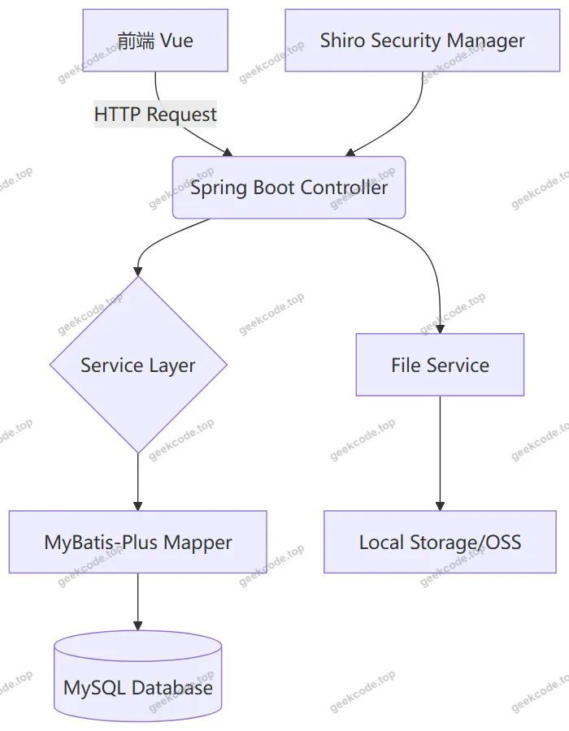</a>

<h2>功能模块</h2>
<h3>前台用户端功能</h3>

前台面向学生及教师用户，提供便捷的自助服务界面。

<ol>
<li><strong>首页展示</strong>：展示网站轮播图、最新公告及热门离校流程入口。</li>
<li><strong>离校流程管理</strong>：</li>
</ol>
<ul>
<li><strong>列表浏览</strong>：查看所有可办理的离校流程事项。</li>
<li><strong>详情查看</strong>：了解具体流程的办理要求、所需材料及状态。</li>
<li><strong>评论互动</strong>：用户对已办结的流程进行评价和留言。</li>
</ul>
<ol start="3">
<li><strong>业务查询</strong>：</li>
</ol>
<ul>
<li><strong>论文审核</strong>：查看论文提交状态及审核结果。</li>
<li><strong>费用结算</strong>：查询学费、住宿费等相关费用的缴纳情况。</li>
<li><strong>教师列表</strong>：浏览指导教师信息及联系方式。</li>
</ul>
<ol start="4">
<li><strong>资讯与服务</strong>：</li>
</ol>
<ul>
<li><strong>网站公告</strong>：查看学校发布的各类通知。</li>
<li><strong>留言反馈</strong>：向管理部门提交建议或问题咨询。</li>
</ul>
<ol start="5">
<li><strong>个人中心</strong>：</li>
</ol>
<ul>
<li><strong>账号管理</strong>：修改个人信息、密码。</li>
<li><strong>我的收藏</strong>：管理收藏的公告或流程事项。</li>
</ul>
<h3>后台管理端功能</h3>

后台面向管理员，提供全系统的配置与数据维护能力。

<ol>
<li><strong>系统管理</strong>：</li>
</ol>
<ul>
<li><strong>用户管理</strong>：新增、编辑、删除管理员、教师及学生账号，重置密码。</li>
<li><strong>配置管理</strong>：设置网站名称、Logo、轮播图等全局参数。</li>
</ul>
<ol start="2">
<li><strong>内容管理</strong>：</li>
</ol>
<ul>
<li><strong>网站公告</strong>：发布、编辑、删除新闻公告。</li>
<li><strong>留言板管理</strong>：查看并回复用户提交的留言反馈。</li>
</ul>
<ol start="3">
<li><strong>业务数据管理</strong>：</li>
</ol>
<ul>
<li><strong>离校流程</strong>：定义和管理各类离校手续的流程节点。</li>
<li><strong>离校流程评论</strong>：审核或删除用户的不良评论。</li>
<li><strong>论文审核</strong>：录入或更新学生的论文审核状态。</li>
<li><strong>费用结算</strong>：管理学生的费用明细及结算状态。</li>
<li><strong>教师管理</strong>：维护教师基本信息。</li>
<li><strong>学生管理</strong>：维护学生学籍及个人信息。</li>
<li><strong>收藏管理</strong>：查看用户的收藏记录。</li>
</ul>
<h2>用户角色与权限</h2>

系统基于 Apache Shiro 实现细粒度的权限控制，主要划分为以下三种角色：

<table>
<thead>
<tr>
<th align="left">角色</th>
<th align="left">权限描述</th>
<th align="left">主要功能范围</th>
</tr>
</thead>
<tbody><tr>
<td align="left"><strong>系统管理员</strong></td>
<td align="left">拥有最高权限，负责系统整体运维与数据监管。</td>
<td align="left">后台所有模块的管理权限，包括用户增删改查、业务数据录入/审核、系统配置修改、公告发布及留言回复。</td>
</tr>
<tr>
<td align="left"><strong>教师</strong></td>
<td align="left">具备部分业务查看与评价权限，主要参与教学相关环节。</td>
<td align="left">前台登录后可查看所指导学生的论文审核状态、费用结算信息；可对离校流程进行评论；管理个人基本信息。具体是否拥有后台特定模块权限需根据实际配置确定，目前截图显示主要为前台业务视角。</td>
</tr>
<tr>
<td align="left"><strong>学生</strong></td>
<td align="left">普通注册用户，主要进行自助式业务办理与信息获取。</td>
<td align="left">前台登录后可浏览离校流程、查看公告、查询论文审核进度、核对费用结算；可进行留言反馈、发表评论、收藏感兴趣的内容；在个人中心维护自身信息。</td>
</tr>
</tbody></table>

<em>注：根据现有源码上下文，未明确区分教师与学生在后台路由中的独立权限差异，通常此类系统中教师可能仅在前台进行业务确认，而管理员在后台进行最终数据归档。</em>

<h2>项目特色与创新点</h2>
<ol>
<li><strong>全流程闭环管理</strong>：系统将传统的线下离校手续转化为线上标准化流程，整合了“流程指引-材料提交-审核反馈-费用清算-评价监督”五个关键环节，消除了信息孤岛，实现了毕业事务的一站式办理。</li>
<li><strong>多维度的互动机制</strong>：引入了“离校流程评论”和“留言反馈”功能，不仅增强了用户之间的信息共享（如经验交流），也为管理部门提供了直接的用户满意度反馈渠道，有助于持续优化服务流程。</li>
<li><strong>个性化的信息聚合</strong>：通过“我的收藏”功能，允许用户针对关注的公告或流程进行标记，结合“个人中心”的数据隔离，提升了信息获取的效率和针对性。</li>
<li><strong>稳健的安全架构</strong>：集成 Shiro 框架实现了基于角色的访问控制（RBAC），确保了敏感数据（如费用、论文成绩）仅对授权用户可见，保障了校园数据的安全性。</li>
</ol>
<h2>部署环境</h2>

为确保系统正常运行，需准备以下软硬件环境：

<h3>硬件环境</h3>
<ul>
<li><strong>服务器</strong>：建议 CPU 4核及以上，内存 8GB 及以上，硬盘 50GB 以上可用空间。</li>
<li><strong>客户端</strong>：现代浏览器（Chrome, Firefox, Edge 等）。</li>
</ul>
<h3>软件环境</h3>
<ul>
<li><strong>操作系统</strong>：Windows Server / Linux (CentOS/Ubuntu)。</li>
<li><strong>JDK</strong>：Java Development Kit 1.8 或更高版本（推荐 JDK 8）。</li>
<li><strong>数据库</strong>：MySQL 5.7 或 MySQL 8.0+，字符集设置为 utf8mb4。</li>
<li><strong>构建工具</strong>：Maven 3.6+（用于后端依赖管理）。</li>
<li><strong>前端运行环境</strong>：Node.js 14.x - 16.x（用于编译 Vue 前端项目），npm 或 yarn。</li>
<li><strong>Web 服务器</strong>：Nginx（用于反向代理及静态资源托管）或 Spring Boot 内置 Tomcat。</li>
</ul>
<h3>部署步骤简述</h3>
<ol>
<li>安装 JDK、MySQL 和 Maven。</li>
<li>导入 SQL 脚本创建数据库 <code>student_graduation</code> 及相关表结构。</li>
<li>修改后端配置文件 <code>application.yml</code>，配置数据库连接 URL、用户名和密码。</li>
<li>使用 Maven 打包后端项目 (<code>mvn clean package</code>)。</li>
<li>进入前端项目目录，执行 <code>npm install</code> 安装依赖，然后 <code>npm run build</code> 生成静态文件。</li>
<li>将生成的 dist 文件夹部署至 Nginx 或直接由 Spring Boot 托管。</li>
<li>启动后端 Jar 包，访问系统地址即可使用。</li>
</ol>
<h2>五、技术特性</h2>
<ul>
<li>前后端集成部署，前端资源打包至后端 static 目录</li>
<li>使用 MyBatis-Plus 简化数据访问层开发</li>
<li>集成 Shiro 权限框架实现角色权限控制</li>
</ul>
<h2>六、功能模块截图</h2>
<h3>前台用户端</h3>
<h4>前台首页</h4>

<a href="https://geekcode.top/archives/%E5%AD%A6%E7%94%9F%E6%AF%95%E4%B8%9A%E7%A6%BB%E6%A0%A1%E7%B3%BB%E7%BB%9F?utm_source=github" title="查看完整源码">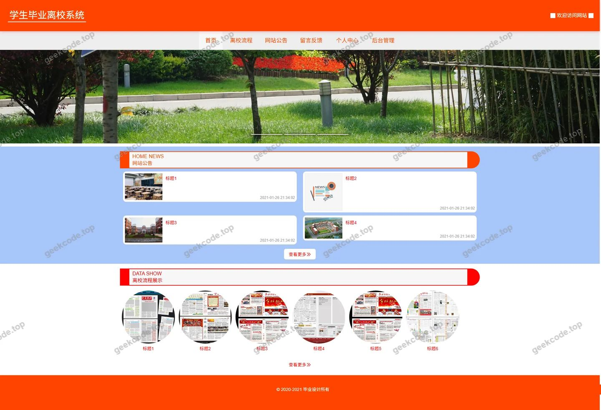</a>

<h4>前台登录页</h4>

<h4>前台注册页</h4>

<a href="https://geekcode.top/archives/%E5%AD%A6%E7%94%9F%E6%AF%95%E4%B8%9A%E7%A6%BB%E6%A0%A1%E7%B3%BB%E7%BB%9F?utm_source=github" title="查看完整源码">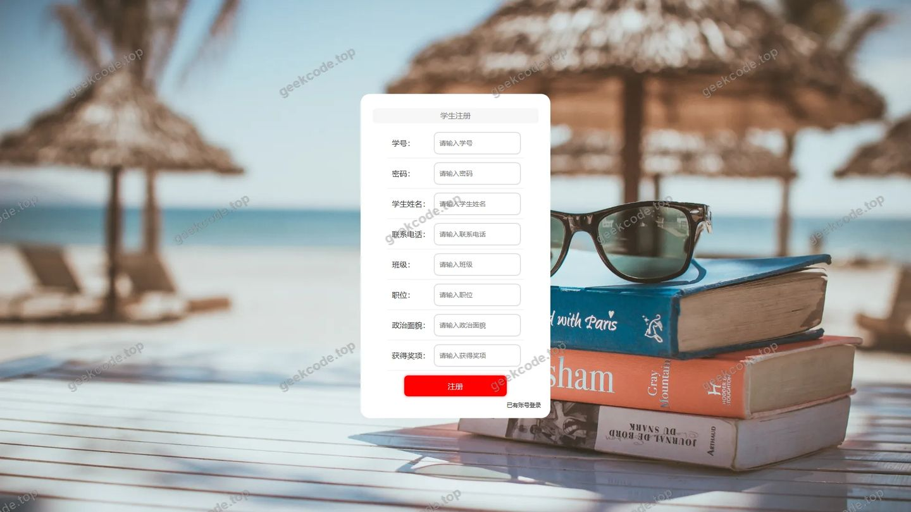</a>

<h4>前台-离校流程列表</h4>

<a href="https://geekcode.top/archives/%E5%AD%A6%E7%94%9F%E6%AF%95%E4%B8%9A%E7%A6%BB%E6%A0%A1%E7%B3%BB%E7%BB%9F?utm_source=github" title="查看完整源码">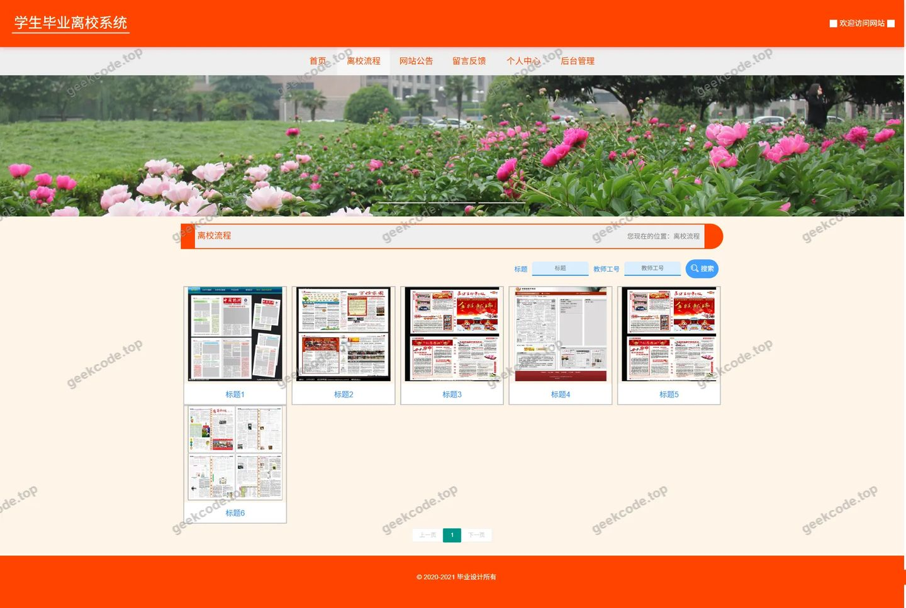</a>

<h4>前台-网站公告列表</h4>

<a href="https://geekcode.top/archives/%E5%AD%A6%E7%94%9F%E6%AF%95%E4%B8%9A%E7%A6%BB%E6%A0%A1%E7%B3%BB%E7%BB%9F?utm_source=github" title="查看完整源码">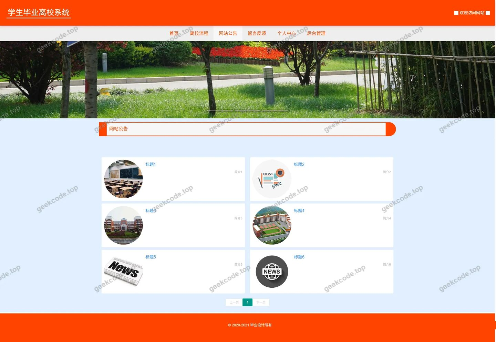</a>

<h4>前台-离校流程评论列表</h4>

<a href="https://geekcode.top/archives/%E5%AD%A6%E7%94%9F%E6%AF%95%E4%B8%9A%E7%A6%BB%E6%A0%A1%E7%B3%BB%E7%BB%9F?utm_source=github" title="查看完整源码">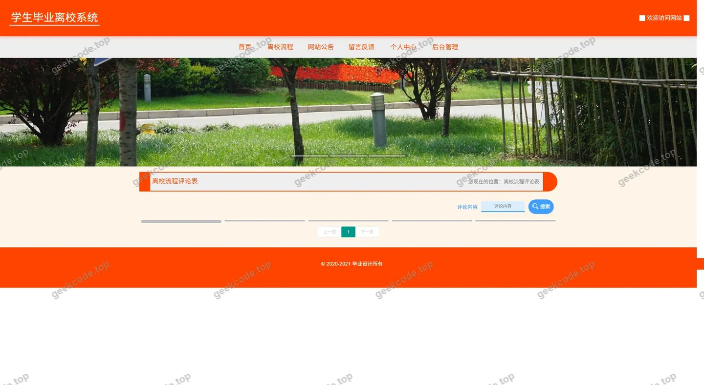</a>

<h4>前台个人中心</h4>

<a href="https://geekcode.top/archives/%E5%AD%A6%E7%94%9F%E6%AF%95%E4%B8%9A%E7%A6%BB%E6%A0%A1%E7%B3%BB%E7%BB%9F?utm_source=github" title="查看完整源码">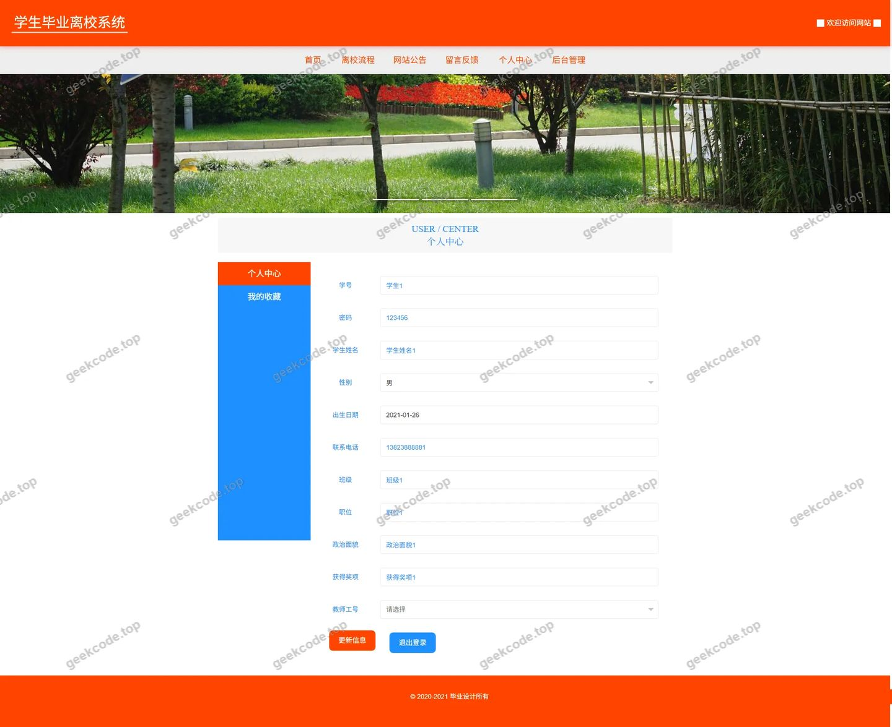</a>

<h4>前台-留言反馈列表</h4>

<a href="https://geekcode.top/archives/%E5%AD%A6%E7%94%9F%E6%AF%95%E4%B8%9A%E7%A6%BB%E6%A0%A1%E7%B3%BB%E7%BB%9F?utm_source=github" title="查看完整源码">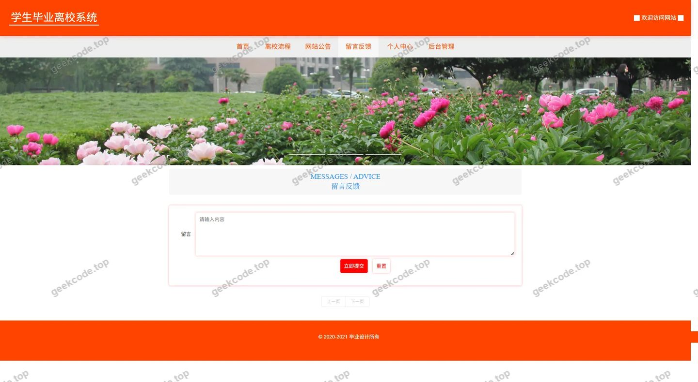</a>

<h4>前台-我的收藏列表</h4>

<a href="https://geekcode.top/archives/%E5%AD%A6%E7%94%9F%E6%AF%95%E4%B8%9A%E7%A6%BB%E6%A0%A1%E7%B3%BB%E7%BB%9F?utm_source=github" title="查看完整源码">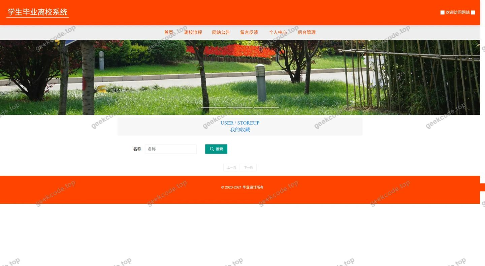</a>

<h4>前台-离校流程-详情</h4>

<a href="https://geekcode.top/archives/%E5%AD%A6%E7%94%9F%E6%AF%95%E4%B8%9A%E7%A6%BB%E6%A0%A1%E7%B3%BB%E7%BB%9F?utm_source=github" title="查看完整源码">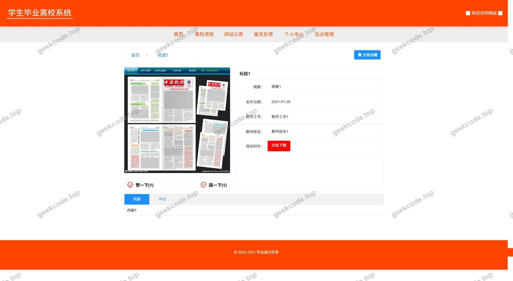</a>

<h4>前台-网站公告-详情</h4>

<a href="https://geekcode.top/archives/%E5%AD%A6%E7%94%9F%E6%AF%95%E4%B8%9A%E7%A6%BB%E6%A0%A1%E7%B3%BB%E7%BB%9F?utm_source=github" title="查看完整源码">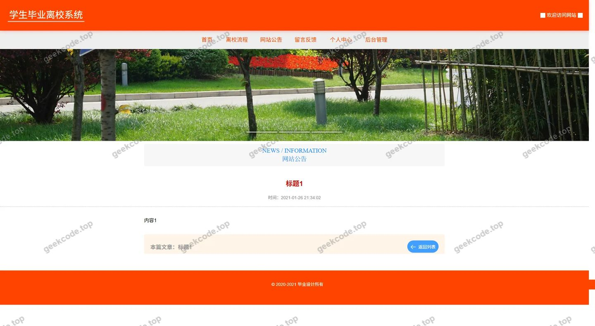</a>

<h4>前台-费用结算列表</h4>

<a href="https://geekcode.top/archives/%E5%AD%A6%E7%94%9F%E6%AF%95%E4%B8%9A%E7%A6%BB%E6%A0%A1%E7%B3%BB%E7%BB%9F?utm_source=github" title="查看完整源码">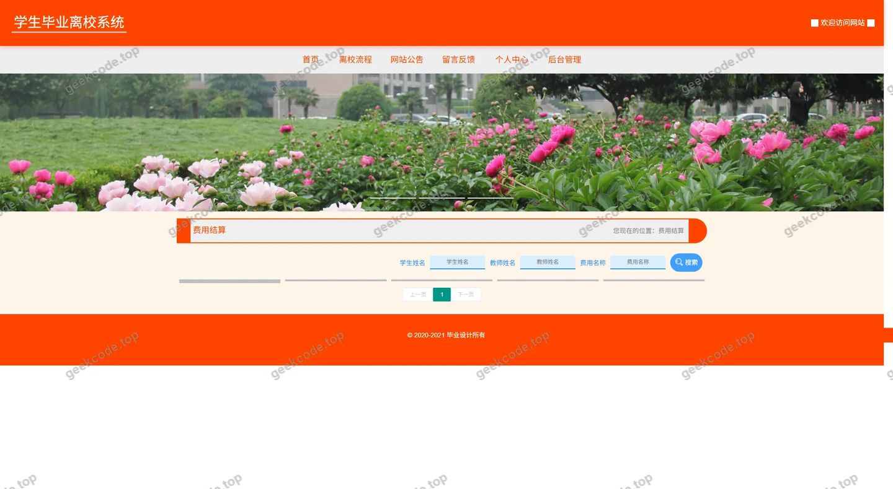</a>

<h4>前台-教师列表</h4>

<h4>前台-论文审核列表</h4>

<h4>前台-离校流程评论-详情</h4>

<h4>前台-费用结算-详情</h4>

<a href="https://geekcode.top/archives/%E5%AD%A6%E7%94%9F%E6%AF%95%E4%B8%9A%E7%A6%BB%E6%A0%A1%E7%B3%BB%E7%BB%9F?utm_source=github" title="查看完整源码">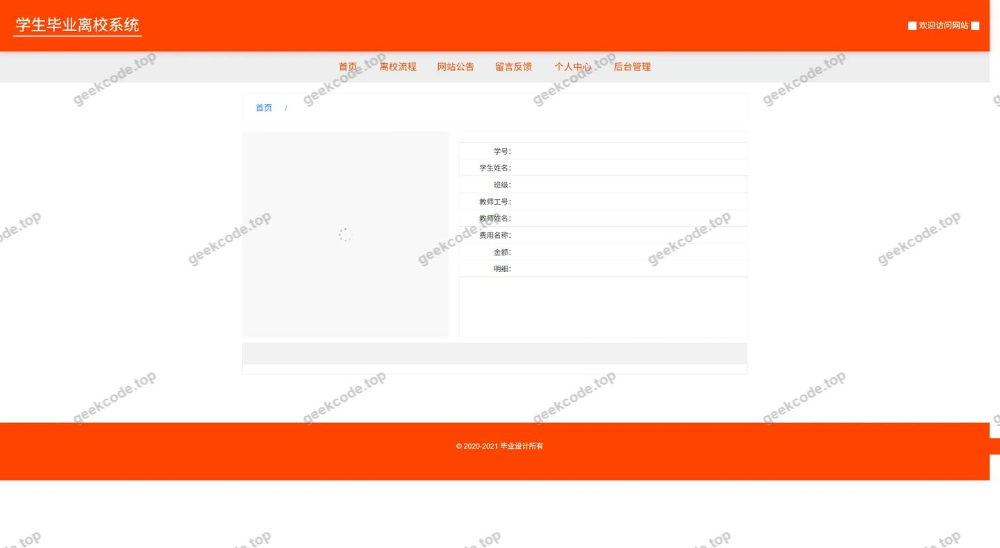</a>

<h4>前台-教师-详情</h4>

<a href="https://geekcode.top/archives/%E5%AD%A6%E7%94%9F%E6%AF%95%E4%B8%9A%E7%A6%BB%E6%A0%A1%E7%B3%BB%E7%BB%9F?utm_source=github" title="查看完整源码">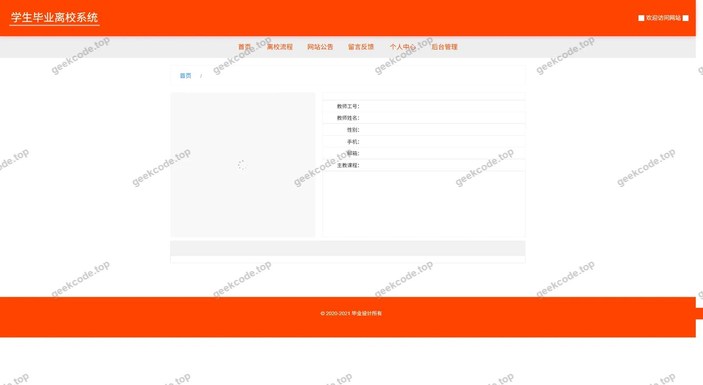</a>

<h4>前台-论文审核-详情</h4>

<a href="https://geekcode.top/archives/%E5%AD%A6%E7%94%9F%E6%AF%95%E4%B8%9A%E7%A6%BB%E6%A0%A1%E7%B3%BB%E7%BB%9F?utm_source=github" title="查看完整源码">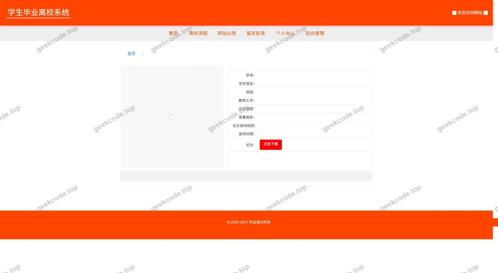</a>

<h3>后台管理端</h3>
<h4>后台-系统配置</h4>

<a href="https://geekcode.top/archives/%E5%AD%A6%E7%94%9F%E6%AF%95%E4%B8%9A%E7%A6%BB%E6%A0%A1%E7%B3%BB%E7%BB%9F?utm_source=github" title="查看完整源码">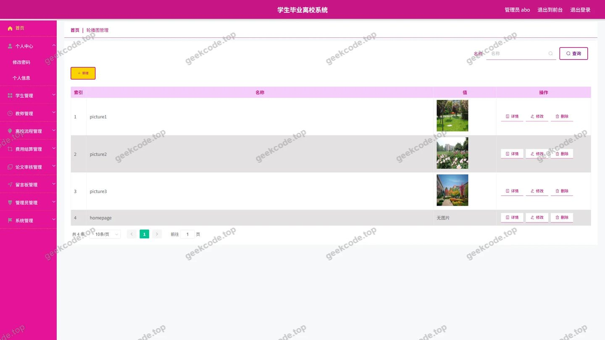</a>

<h4>后台-离校流程评论</h4>

<a href="https://geekcode.top/archives/%E5%AD%A6%E7%94%9F%E6%AF%95%E4%B8%9A%E7%A6%BB%E6%A0%A1%E7%B3%BB%E7%BB%9F?utm_source=github" title="查看完整源码">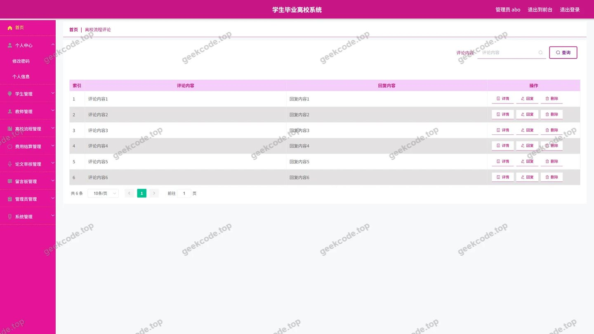</a>

<h4>后台-费用结算</h4>

<a href="https://geekcode.top/archives/%E5%AD%A6%E7%94%9F%E6%AF%95%E4%B8%9A%E7%A6%BB%E6%A0%A1%E7%B3%BB%E7%BB%9F?utm_source=github" title="查看完整源码">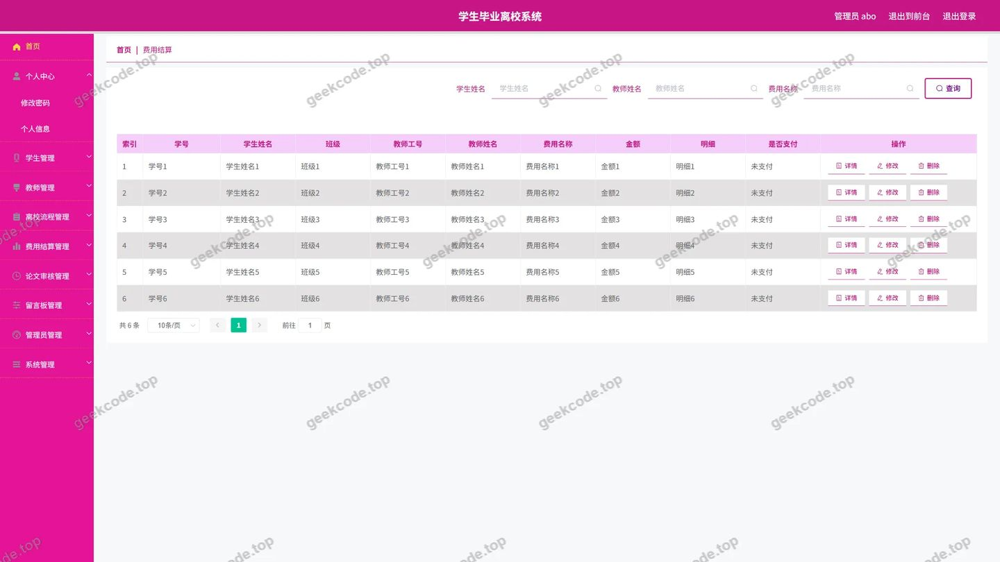</a>

<h4>后台首页</h4>

<a href="https://geekcode.top/archives/%E5%AD%A6%E7%94%9F%E6%AF%95%E4%B8%9A%E7%A6%BB%E6%A0%A1%E7%B3%BB%E7%BB%9F?utm_source=github" title="查看完整源码">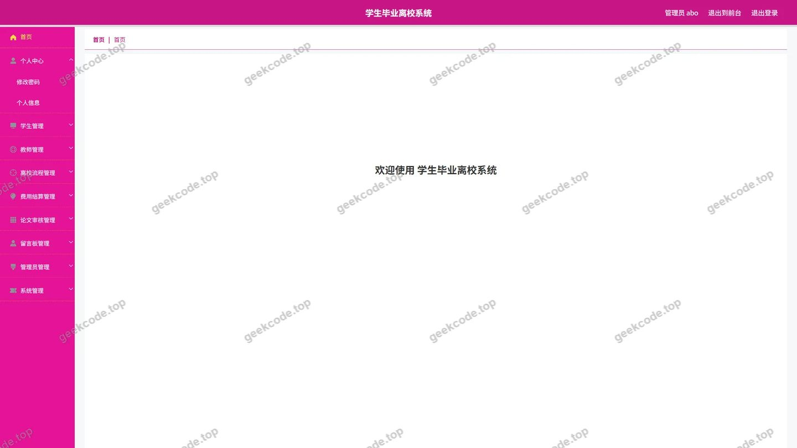</a>

<h4>后台-教师</h4>

<a href="https://geekcode.top/archives/%E5%AD%A6%E7%94%9F%E6%AF%95%E4%B8%9A%E7%A6%BB%E6%A0%A1%E7%B3%BB%E7%BB%9F?utm_source=github" title="查看完整源码">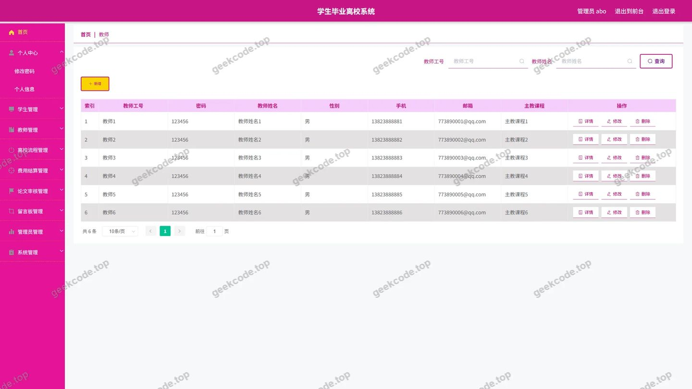</a>

<h4>后台-离校流程</h4>

<a href="https://geekcode.top/archives/%E5%AD%A6%E7%94%9F%E6%AF%95%E4%B8%9A%E7%A6%BB%E6%A0%A1%E7%B3%BB%E7%BB%9F?utm_source=github" title="查看完整源码">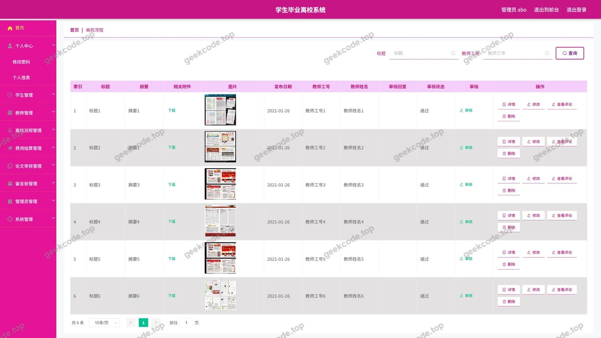</a>

<h4>后台-登录</h4>

<h4>后台-论文审核</h4>

<a href="https://geekcode.top/archives/%E5%AD%A6%E7%94%9F%E6%AF%95%E4%B8%9A%E7%A6%BB%E6%A0%A1%E7%B3%BB%E7%BB%9F?utm_source=github" title="查看完整源码">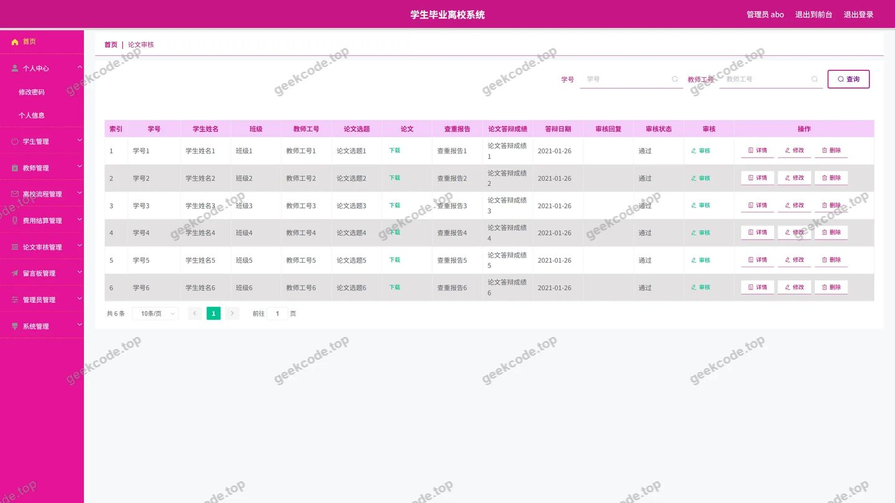</a>

<h4>后台-留言板</h4>

<a href="https://geekcode.top/archives/%E5%AD%A6%E7%94%9F%E6%AF%95%E4%B8%9A%E7%A6%BB%E6%A0%A1%E7%B3%BB%E7%BB%9F?utm_source=github" title="查看完整源码">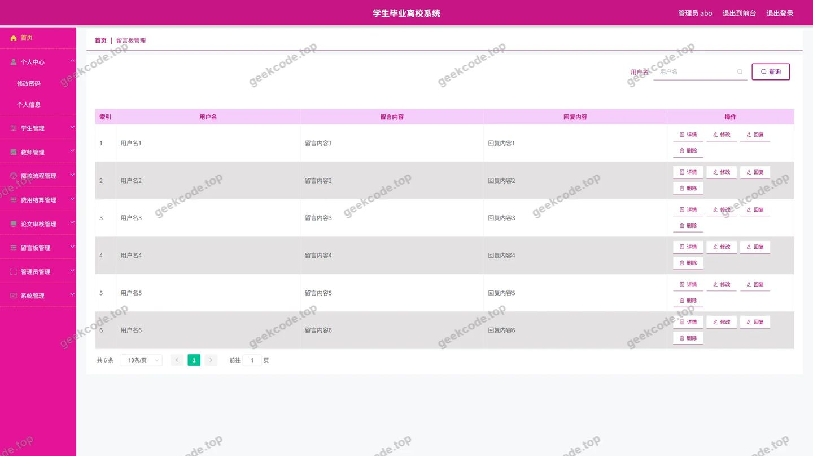</a>

<h4>后台-公告信息</h4>

<a href="https://geekcode.top/archives/%E5%AD%A6%E7%94%9F%E6%AF%95%E4%B8%9A%E7%A6%BB%E6%A0%A1%E7%B3%BB%E7%BB%9F?utm_source=github" title="查看完整源码">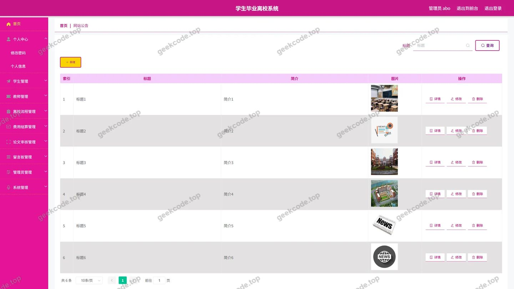</a>

<h4>后台-收藏</h4>

<a href="https://geekcode.top/archives/%E5%AD%A6%E7%94%9F%E6%AF%95%E4%B8%9A%E7%A6%BB%E6%A0%A1%E7%B3%BB%E7%BB%9F?utm_source=github" title="查看完整源码">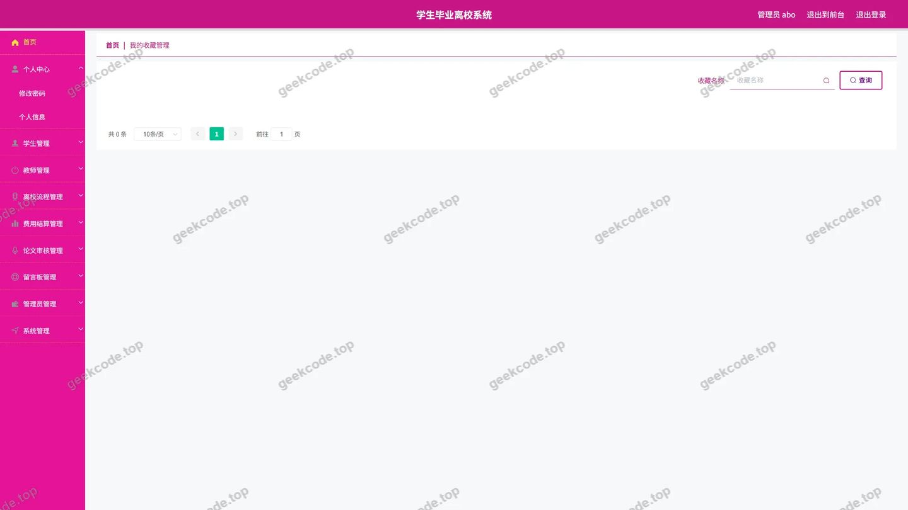</a>

<h4>后台-学生</h4>

<a href="https://geekcode.top/archives/%E5%AD%A6%E7%94%9F%E6%AF%95%E4%B8%9A%E7%A6%BB%E6%A0%A1%E7%B3%BB%E7%BB%9F?utm_source=github" title="查看完整源码">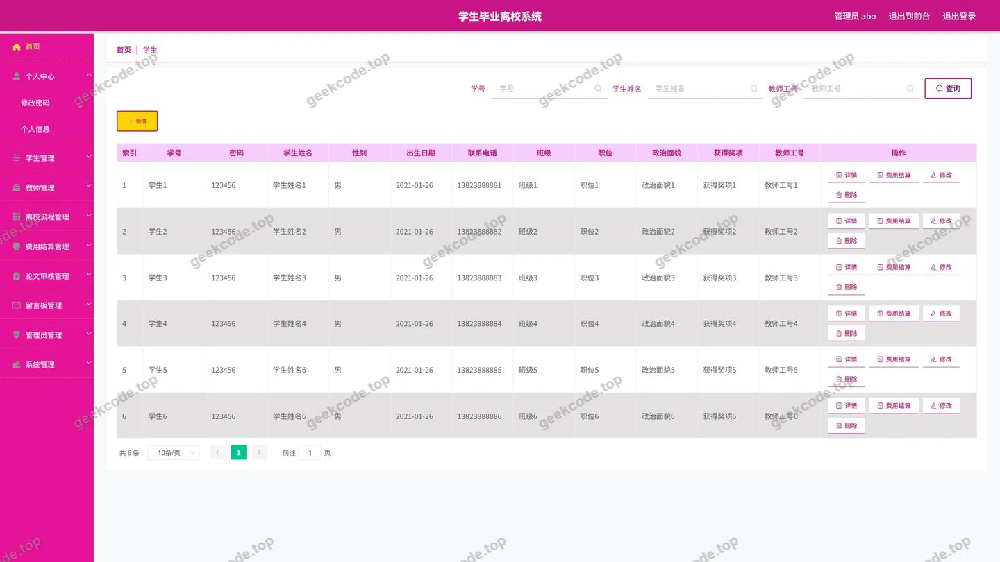</a>

---

## 获取完整源码

| 项目 | 说明 |
| --- | --- |
| 项目名 | 学生毕业离校系统 |
| 运行截图 | 本文 31 张（站点带水印原图，仓库 `images/` 目录） |
| 完整源码 | [https://geekcode.top/archives/%E5%AD%A6%E7%94%9F%E6%AF%95%E4%B8%9A%E7%A6%BB%E6%A0%A1%E7%B3%BB%E7%BB%9F?utm_source=github](https://geekcode.top/archives/%E5%AD%A6%E7%94%9F%E6%AF%95%E4%B8%9A%E7%A6%BB%E6%A0%A1%E7%B3%BB%E7%BB%9F?utm_source=github) |
| 咨询微信 | **ir9372**（备注：jingpin-yuanma） |
| 更多项目 | [极客代码 geekcode.top](https://geekcode.top/?utm_source=github) |

> 需要源码、部署、改配置、跑不起来等问题，加微信 ir9372 沟通，说明项目名即可。
